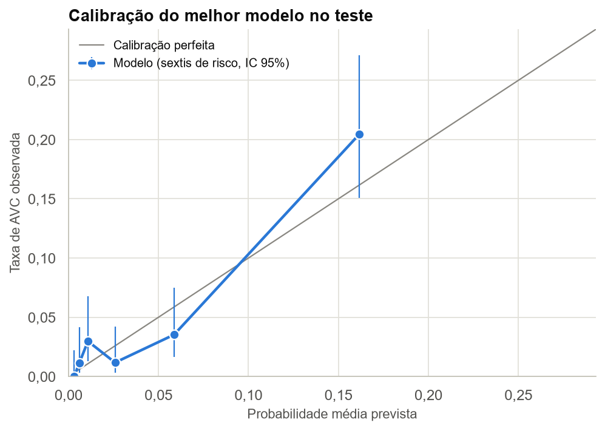

# Discussão Crítica

As limitações abaixo não foram tratadas nas seções anteriores. Os cálculos que as sustentam estão junto de cada uma.

## 4.1 Limitações do melhor modelo

**Limitação 1: baixa sensibilidade para AVC em pacientes abaixo de 60 anos no conjunto de teste.** Abaixo de 60 anos, detectou 0 de 12 AVCs (IC 95% exato de 0% a 26,5%) e sinalizou 1,5% dos pacientes; a partir dos 60, detectou 86,8% e sinalizou 51,1%. Esses 12 casos são a maioria dos 17 falsos negativos. Também há diferença por sexo: recall de 75,9% no feminino e 52,4% no masculino, com precisão de 27,5% e 15,7%, embora com poucos eventos (29 e 21). Um modelo só com idade já alcança AP de 0,169 na validação cruzada, contra 0,252 do modelo completo, o que mostra quanto do desempenho vem dessa variável.

O desempenho agregado esconde esse padrão. O TRIPOD+AI recomenda reportar o desempenho em subgrupos relevantes (Collins et al., 2024). Um uso real exigiria avaliar o modelo por faixa etária e coletar mais casos em pacientes jovens.

| Grupo (teste) | Pacientes | AVCs | Sinalizados | Recall | Precision |
|---|---:|---:|---:|---:|---:|
| Idade abaixo de 60 | 750 | 12 | 1,5% | 0,0% | 0,0% |
| Idade de 60 ou mais | 272 | 38 | 51,1% | 86,8% | 23,7% |
| Feminino | 599 | 29 | 13,4% | 75,9% | 27,5% |
| Masculino | 423 | 21 | 16,5% | 52,4% | 15,7% |

**Limitação 2: as probabilidades e a precisão só valem para populações parecidas com esta amostra.** No teste, o risco médio previsto (4,45%) ficou próximo da prevalência observada (4,89%), e o Brier score foi inferior ao do Dummy (0,0415 contra 0,0465). Entretanto, esses resultados não garantem boa calibração em todas as faixas de risco. No sexto de maior risco, por exemplo, a probabilidade média prevista foi de 16,2%, enquanto a taxa observada de AVC foi de 20,5%.

Além disso, com o mesmo recall e a mesma especificidade, a precisão cairia de 22,4% em uma prevalência de 5% para 10,1% em uma de 2% e 5,2% em uma de 1%. Como não sabemos como a amostra foi formada, os 4,9% podem não representar a população de uso. Probabilidades mal calibradas podem prejudicar decisões clínicas (Van Calster et al., 2019), então a calibração precisaria ser verificada em dados externos antes de qualquer uso.

| Sexto de risco | Risco previsto | Taxa observada | IC 95% (Wilson) | Pacientes | AVCs |
|---|---:|---:|---:|---:|---:|
| 1 | 0,3% | 0,0% | 0,0% a 2,2% | 171 | 0 |
| 2 | 0,6% | 1,2% | 0,3% a 4,1% | 172 | 2 |
| 3 | 1,1% | 3,0% | 1,3% a 6,8% | 168 | 5 |
| 4 | 2,6% | 1,2% | 0,3% a 4,2% | 170 | 2 |
| 5 | 5,9% | 3,5% | 1,6% a 7,5% | 170 | 6 |
| 6 | 16,2% | 20,5% | 15,1% a 27,1% | 171 | 35 |

| Prevalência na população de uso | Precision esperada |
|---|---:|
| 1% | 5,2% |
| 2% | 10,1% |
| 5% | 22,4% |
| 10% | 37,9% |

## 4.2 Limitações dos dados

**Limitação 1: origem e ordem temporal desconhecidas.** A página do dataset identifica a fonte apenas como *Confidential Source* e indica uso somente educacional (Fedesoriano, 2021). Não há informação sobre população, local, período ou critérios de inclusão. Também não há datas: não sabemos se glicose, `bmi`, tabagismo e comorbidades foram medidos antes do AVC, nem em que janela de tempo o `stroke` ocorreu. Portanto, as métricas descrevem associações nesta amostra, e não a previsão de um evento futuro. Preditores medidos depois do desfecho são uma forma conhecida de vazamento (Kapoor; Narayanan, 2023), que aqui não pode ser verificada.

**Limitação 2: faltam preditores clínicos importantes, e os disponíveis são grosseiros.** A base não traz fibrilação atrial, fator de risco independente para AVC (Wolf; Abbott; Kannel, 1991), nem valores de pressão arterial ou uso de anti-hipertensivos, presentes no perfil de risco de Framingham (Wolf et al., 1991). Também faltam fatores avaliados no INTERSTROKE, como atividade física, dieta, lipídios, álcool e fatores psicossociais; em conjunto, os fatores desse estudo responderam por cerca de 90% do risco atribuível populacional (O'Donnell et al., 2016).

Os dados disponíveis também são limitados: `hypertension` e `heart_disease` são binárias, `smoking_status` é `Unknown` em 30% dos registros, e `stroke` não separa AVC isquêmico de hemorrágico, que têm perfis de risco diferentes (O'Donnell et al., 2016). Essas lacunas podem limitar a capacidade preditiva do modelo e contribuir para sua baixa precisão, embora não seja possível quantificar seu impacto sem dados adicionais.

## 4.3 Operacionalização e manutenção

**Ação 1: validação silenciosa e monitoramento contínuo.** Antes de influenciar qualquer decisão, o modelo rodaria em modo silencioso sobre pacientes reais: as previsões são registradas, mas não mostradas à equipe. Isso permite estimar o desempenho prospectivo e esclarecer por que o `bmi` fica ausente.

Em seguida, o monitoramento acompanharia a distribuição das entradas, a taxa de `bmi` ausente (4,2% no treino) e a de pacientes sinalizados (14,7% no teste) e, quando os desfechos forem conhecidos, AP, calibração e recall por faixa etária. Mudanças de tecnologia, população ou comportamento degradam modelos clínicos: um modelo de sepse amplamente usado precisou ser desativado em um hospital por alertas espúrios durante a pandemia (Finlayson et al., 2021).

**Ação 2: versionamento conjunto e atualização por gatilho.** Pré-processamento, modelo e limiar seriam distribuídos como um único artefato versionado, com versões fixas das bibliotecas e validação do esquema de entrada (tipos, faixas e categorias novas). Mudar uma parte afeta as demais, e essas dependências são fonte conhecida de dívida técnica em sistemas de ML (Sculley et al., 2015).

A atualização seria acionada pelo monitoramento, e não por calendário fixo, como recomendam Davis et al. (2017), que observaram a calibração piorar mesmo com a discriminação estável. Antes de qualquer atualização, deve-se investigar a causa da degradação do desempenho. Dependendo do problema identificado, podem ser necessárias recalibração, revisão do pré-processamento ou novo treinamento. Cada nova versão deve ser avaliada em dados recentes e por subgrupo antes de substituir a anterior.

## Conclusão

- O Gradient Boosting com indicador de `bmi` ausente alcançou no teste AP de 0,240, cerca de 5 vezes a do Dummy (0,049), e ROC-AUC de 0,840. Com o limiar de F2, teve recall de 0,66 e precisão de 0,22.
- A idade concentra a maior parte do sinal, e o modelo não detectou nenhum dos 12 AVCs abaixo de 60 anos no teste.
- A mudança no pipeline corrigiu uma afirmação da APS1 e sugeriu ganho na validação cruzada, mas esse ganho não se confirmou no teste. A versão sem indicador é a alternativa mais segura para uso real.
- As diferenças entre os modelos são pequenas diante do ruído. A curva de aprendizado e os preditores ausentes indicam que o próximo ganho tende a vir de mais casos e de variáveis clínicas melhores, e não de modelos mais complexos.
- Qualquer uso clínico exigiria antes validação externa e prospectiva, verificação da calibração e avaliação por subgrupo.
