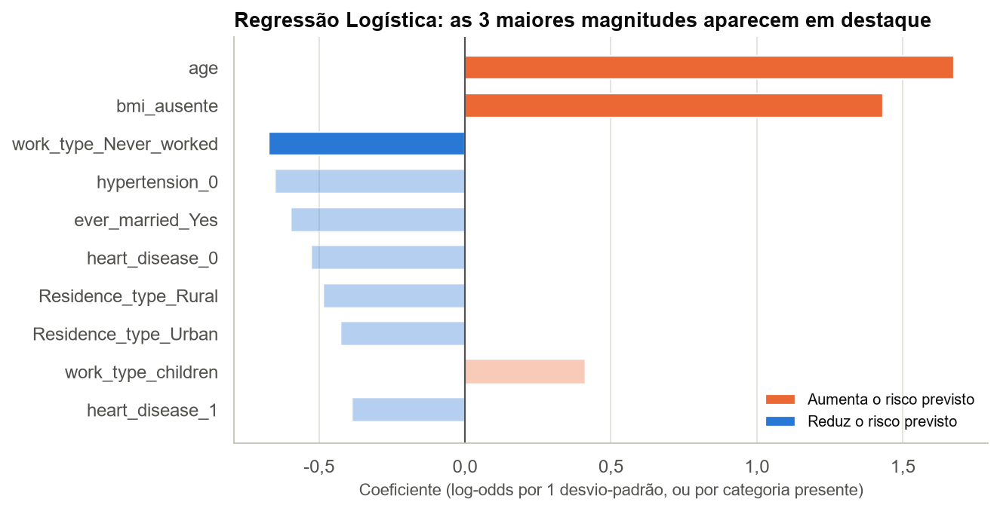
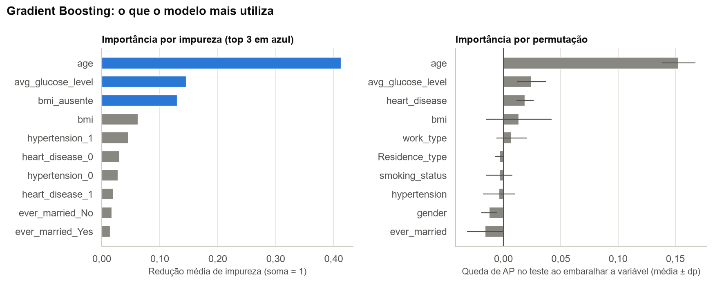
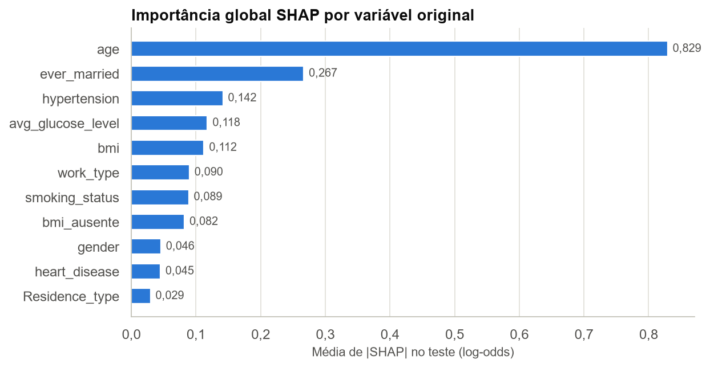
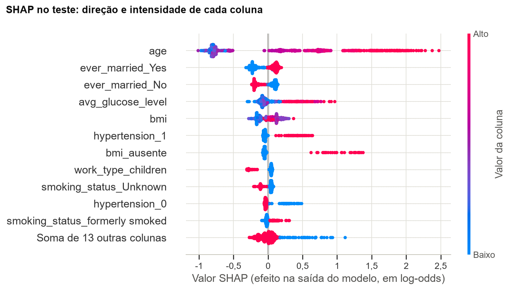
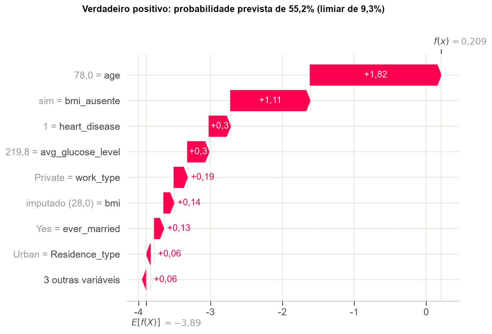
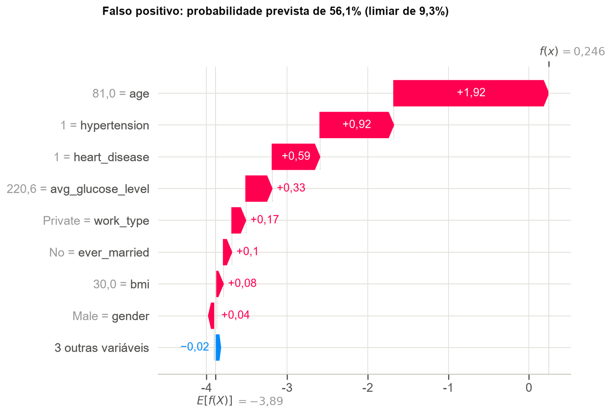
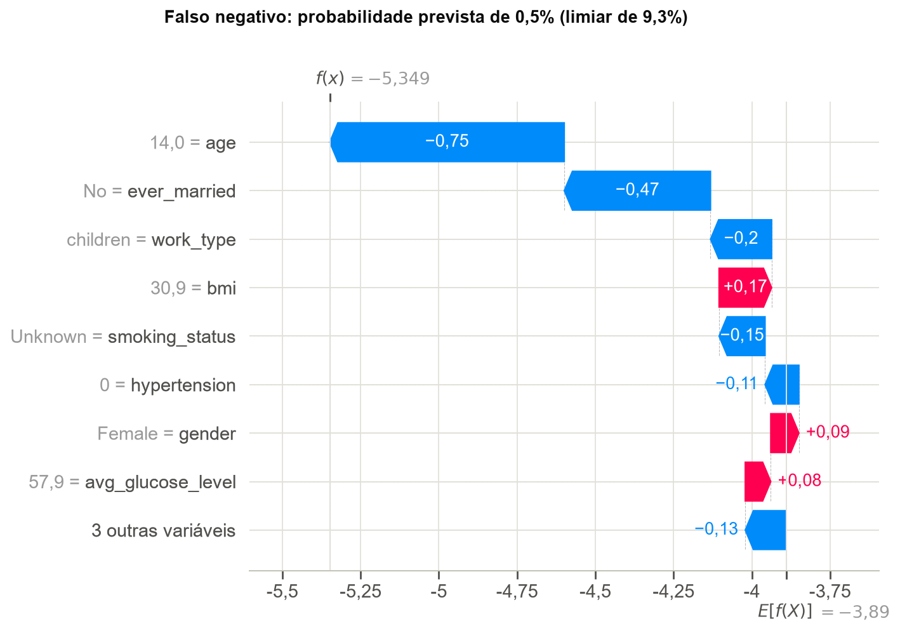

# Interpretação e Explicabilidade

## 3.1 Modelo linear: as 3 maiores magnitudes

Analisamos a regressão logística ajustada com o pipeline final (`C = 100`, Elastic Net). As variáveis numéricas estão padronizadas, então seus coeficientes valem por 1 desvio-padrão; os das colunas one-hot valem para a presença da categoria.



| Coluna | Coeficiente | Razão de chances |
|---|---:|---:|
| `age` | 1,675 | 5,34 |
| `bmi_ausente` | 1,432 | 4,19 |
| `work_type_Never_worked` | -0,673 | 0,51 |
| `hypertension_0` | -0,649 | 0,52 |
| `ever_married_Yes` | -0,595 | 0,55 |
| `heart_disease_0` | -0,524 | 0,59 |

**As 3 maiores magnitudes:**

1. **`age` (+1,675; razão de chances de 5,34 por desvio-padrão de 22,6 anos, ou 2,10 por década):** o maior efeito do modelo, coerente com a EDA.
2. **`bmi_ausente` (+1,432; razão de chances de 4,19):** mantidas as demais variáveis, a ausência de `bmi` está associada a chances (odds) estimadas de AVC aproximadamente 4,19 vezes maiores, valor próximo ao estimado na Seção 1.3. Carrega o risco de vazamento discutido naquela seção.
3. **`work_type_Never_worked` (-0,673; razão de chances de 0,51):** não deve ser lido como proteção. A categoria tem 13 pacientes no treino, nenhum com AVC, e idade mediana de 17 anos.

**Cuidado com colunas one-hot.** Como o pipeline mantém todas as categorias, uma coluna de cada variável é redundante, e só a **diferença** entre categorias é identificável. `Residence_type_Rural` (-0,484) e `Residence_type_Urban` (-0,425) parecem importantes, mas a diferença entre elas é de apenas 0,059. A tabela de contrastes traz a leitura correta: hipertensão tem razão de chances de 1,48; doença cardíaca, de 1,15; e fumar em comparação a nunca ter fumado, de 1,26.

Esses valores são associações condicionais, e não efeitos causais comparáveis entre si (Westreich; Greenland, 2013).

| Contraste | Diferença de log-odds | Razão de chances |
|---|---:|---:|
| `work_type_Never_worked vs work_type_Private` | -0,644 | 0,53 |
| `work_type_children vs work_type_Private` | 0,440 | 1,55 |
| `hypertension_1 vs hypertension_0` | 0,390 | 1,48 |
| `work_type_Self-employed vs work_type_Private` | -0,294 | 0,75 |
| `ever_married_Yes vs ever_married_No` | -0,281 | 0,76 |
| `smoking_status_smokes vs smoking_status_never smoked` | 0,235 | 1,26 |
| `smoking_status_formerly smoked vs smoking_status_never smoked` | 0,191 | 1,21 |
| `heart_disease_1 vs heart_disease_0` | 0,139 | 1,15 |
| `Residence_type_Urban vs Residence_type_Rural` | 0,059 | 1,06 |
| `gender_Male vs gender_Female` | 0,037 | 1,04 |

## 3.2 Modelo ensemble: as 3 maiores importâncias



| Coluna | Importância por impureza |
|---|---:|
| `age` | 0,413 |
| `avg_glucose_level` | 0,146 |
| `bmi_ausente` | 0,131 |
| `bmi` | 0,063 |
| `hypertension_1` | 0,047 |
| `heart_disease_0` | 0,031 |

| Variável original | Queda de AP (permutação) | Desvio-padrão |
|---|---:|---:|
| `age` | 0,153 | 0,014 |
| `avg_glucose_level` | 0,025 | 0,013 |
| `heart_disease` | 0,019 | 0,008 |
| `bmi` | 0,013 | 0,029 |
| `work_type` | 0,007 | 0,013 |

**As 3 maiores importâncias por impureza:**

1. **`age` (0,413):** a variável dominante, como na regressão logística.
2. **`avg_glucose_level` (0,146):** a EDA já mostrava glicemia mais alta entre os casos de AVC.
3. **`bmi_ausente` (0,131):** peso alto para uma coluna binária e rara, reflexo da associação vista no treino.

A importância por impureza é calculada no treino e pode favorecer variáveis com muitos valores possíveis (Strobl et al., 2007), então a conferimos por permutação no teste. Essa conferência confirma `age` (queda de AP de 0,153) e `avg_glucose_level` (0,025). Já `bmi`, que inclui o indicador porque embaralhar a coluna também embaralha as ausências, tem queda de 0,013 com desvio-padrão de 0,029, compatível com zero. O resultado concorda com a Seção 2.6.

## 3.3 SHAP no melhor modelo

O melhor modelo é um ensemble de árvores, então usamos o `TreeExplainer`, que calcula valores SHAP (Lundberg; Lee, 2017) de forma exata para árvores. Os valores estão em log-odds e somam, com o valor-base, a saída do modelo para cada paciente, propriedade conferida no código. Por essa aditividade, somamos as colunas one-hot para obter a contribuição de cada variável original.

```python
explicador = shap.TreeExplainer(clf_melhor)
explicacao = explicador(X_teste_t)
valores, base = explicacao.values, np.ravel(explicacao.base_values)
assert np.allclose(base + valores.sum(axis=1), clf_melhor.decision_function(X_teste_t), atol=1e-6)
```

### Importância global





- **`age` (0,829)** domina, com três vezes o peso da segunda variável. Quanto maior a idade, maior o risco previsto.
- **`ever_married` (0,267)** aparece em segundo, mas provavelmente funciona como substituto da idade: a idade mediana é de 18 anos entre os que nunca se casaram e de 53 entre os demais. Embaralhá-la não reduz a AP (Seção 3.2) porque as medidas respondem a perguntas diferentes: o SHAP mede quanto a variável move cada previsão, inclusive a de jovens de baixo risco, enquanto a AP depende principalmente da ordem no topo do ranking.
- **`hypertension` (0,142), `avg_glucose_level` (0,118) e `bmi` (0,112)** vêm a seguir. Hipertensão e glicose altas aumentam o risco. O efeito de `bmi` não é monotônico: valores baixos reduzem o risco, e valores intermediários são os que mais o aumentam.
- **`bmi_ausente` (0,082)** tem média baixa porque só 3% dos pacientes do teste estão nesse grupo. Para esses 31 pacientes, o efeito médio é de +1,07 log-odds, ou cerca de 2,9 vezes a chance.

### Três predições individuais

Escolhemos três casos do teste: o verdadeiro positivo mais confiante, o falso positivo com maior probabilidade e o falso negativo com menor probabilidade. Cada gráfico parte do valor-base, E[f(X)] = -3,89 (probabilidade de 2,0%, abaixo da prevalência porque é uma média em log-odds), e soma as contribuições até a saída do modelo, f(x).



**Verdadeiro positivo (paciente 13, com AVC, probabilidade de 55,2%).** Homem de 78 anos com doença cardíaca, glicose de 219,8 e sem `bmi` registrado. As maiores contribuições são idade (+1,82), `bmi` ausente (+1,11), doença cardíaca (+0,30) e glicose (+0,30). Este acerto depende parcialmente do indicador de `bmi` ausente. Sem sua contribuição na decomposição SHAP, a probabilidade calculada seria de aproximadamente 29%, ainda acima do limiar. Essa estimativa é apenas uma decomposição matemática, não uma nova previsão do modelo.



**Falso positivo (paciente 3318, sem AVC registrado, probabilidade de 56,1%).** Homem de 81 anos com hipertensão, doença cardíaca e glicose de 220,6. Idade (+1,92), hipertensão (+0,92), doença cardíaca (+0,59) e glicose (+0,33) explicam a previsão. O modelo atribuiu alta probabilidade de AVC devido à combinação de idade elevada, hipertensão, doença cardíaca e glicose elevada. Embora o registro indique ausência de AVC, esse caso ilustra como o classificador pode produzir falsos positivos em indivíduos com características associadas ao desfecho.



**Falso negativo (paciente 245, com AVC, probabilidade de 0,5%).** Paciente de 14 anos, do sexo feminino, com `work_type = children` e sem hipertensão ou doença cardíaca. Idade (-0,75), `ever_married` (-0,47) e `work_type` (-0,20) reduzem o risco, e só o `bmi` de 30,9 (+0,17) o aumenta de forma relevante. As três maiores contribuições refletem, na prática, a pouca idade. O treino tem apenas 3 AVCs em 1.780 pacientes de até 40 anos, então o modelo tem pouco com que aprender esse padrão.
