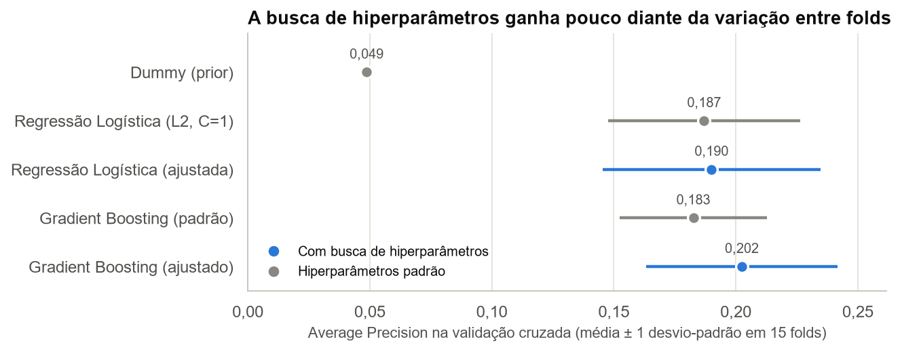
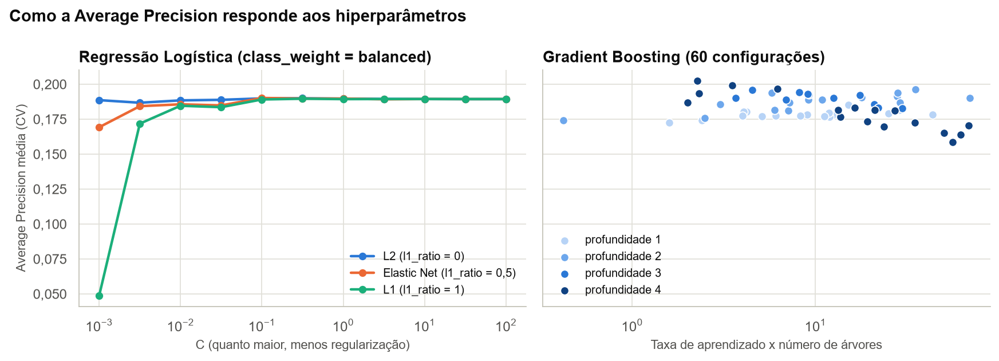

# Modelos e Hiperparâmetros

## Dados e estratégia de validação

O conjunto de dados e a separação são os mesmos da APS1. O **conjunto de teste fica intocado até a Seção 2**: toda a seleção de modelos, hiperparâmetros, pipeline e limiar usa apenas o treino.

Reconstruímos a definição do pipeline da APS1 em vez de carregar o `.joblib` exportado naquela etapa. Aquele arquivo já foi ajustado com todo o treino, e reutilizá-lo na validação cruzada vazaria estatísticas dos folds de validação. Encadear pré-processamento e estimador em um único `Pipeline` faz cada fold ajustar os dois apenas com seus dados de treino.

**Métrica: Average Precision (AP).** Resume a curva Precision-Recall sem depender de um limiar de decisão. Com apenas 4,9% de casos positivos, essa curva é mais informativa do que a ROC, pois mostra a fração de acertos entre os pacientes sinalizados (Saito; Rehmsmeier, 2015). A referência sem habilidade é a própria prevalência (cerca de 0,049), e a conclusão da APS1 já indicava essa métrica.

**Validação: 5 folds estratificados com 3 repetições**, totalizando 15 avaliações. Com 199 AVCs no treino, cada fold de validação tem cerca de 40 casos positivos, e uma única divisão seria ruidosa. Todas as comparações usam exatamente os mesmos folds.

**Comparação entre modelos: teste t pareado corrigido** de Nadeau e Bengio (2003). Folds repetidos compartilham dados e não são independentes, e o teste t comum subestimaria a incerteza.

## 1.1 Os três modelos

| Modelo | Papel | Justificativa |
|---|---|---|
| Dummy (`strategy="prior"`) | Referência | Atribui a todos a prevalência do treino e mostra o resultado sem nenhuma habilidade |
| Regressão logística regularizada | Modelo linear | Simples e interpretável; a regularização controla a variância quando há poucos eventos |
| Gradient Boosting | Ensemble de árvores | Capta não linearidades e interações (Friedman, 2001), coerente com a falta de separação linear vista no PCA da APS1. Preferido ao `HistGradientBoostingClassifier`, que não expõe `feature_importances_`, usado na Seção 3 |

| Modelo (hiperparâmetros padrão) | AP média | Desvio-padrão | Vezes a prevalência |
|---|---:|---:|---:|
| Dummy (prior) | 0,049 | 0,000 | 1,0 |
| Regressão Logística (L2, C=1) | 0,187 | 0,039 | 3,8 |
| Gradient Boosting (padrão) | 0,183 | 0,030 | 3,8 |

Os dois modelos têm AP de cerca de 3,8 vezes a prevalência, portanto há sinal a ser aproveitado. Com hiperparâmetros padrão, a regressão logística (0,187) e o Gradient Boosting (0,183) estão empatados: a diferença é muito menor que a variação entre folds (desvio-padrão de 0,03 a 0,04).

## 1.2 Seleção de hiperparâmetros

**Regressão logística com `GridSearchCV`:** poucos hiperparâmetros e ajuste barato permitem testar as 66 combinações de `C`, tipo de penalidade (L2, L1 ou Elastic Net) e `class_weight`.

**Gradient Boosting com `RandomizedSearchCV`:** seis hiperparâmetros, alguns contínuos, tornariam uma grade completa cara. A busca aleatória explora esse espaço com mais eficiência (Bergstra; Bengio, 2012), e testamos 60 configurações.

As duas buscas usam a mesma métrica e os mesmos folds.

```python
GRADE_LR = {
    "clf__C": np.logspace(-3, 2, 11),
    "clf__l1_ratio": [0.0, 0.5, 1.0],
    "clf__class_weight": [None, "balanced"],
}
DIST_GB = {
    "clf__n_estimators": randint(50, 601),
    "clf__learning_rate": loguniform(0.005, 0.2),
    "clf__max_depth": [1, 2, 3, 4],
    "clf__min_samples_leaf": randint(1, 61),
    "clf__subsample": uniform(0.5, 0.5),
    "clf__max_features": [None, "sqrt"],
}
cv = RepeatedStratifiedKFold(n_splits=5, n_repeats=3, random_state=42)
```

| Modelo | AP média | Desvio-padrão | Vezes a prevalência |
|---|---:|---:|---:|
| Dummy (prior) | 0,049 | 0,000 | 1,0 |
| Regressão Logística (L2, C=1) | 0,187 | 0,039 | 3,8 |
| Gradient Boosting (padrão) | 0,183 | 0,030 | 3,8 |
| Regressão Logística (ajustada) | 0,190 | 0,045 | 3,9 |
| Gradient Boosting (ajustado) | 0,202 | 0,039 | 4,2 |

| Modelo | Melhores hiperparâmetros |
|---|---|
| Regressão logística | `C` = 0,1, Elastic Net (`l1_ratio` = 0,5), `class_weight` = balanced |
| Gradient Boosting | `learning_rate` = 0,039, `n_estimators` = 58, `max_depth` = 4, `min_samples_leaf` = 55, `subsample` = 0,64, `max_features` = None |



A busca trouxe ganho pequeno: a regressão logística passou de 0,187 para 0,190, e o Gradient Boosting, de 0,183 para 0,202. O Gradient Boosting ajustado é o melhor modelo até aqui, mas sua vantagem sobre a regressão logística (+0,012; IC 95% de -0,027 a +0,052; p = 0,51) não é estatisticamente significativa. Esses resultados podem ser otimistas, pois os hiperparâmetros foram selecionados utilizando os mesmos folds empregados na comparação. Por isso, os intervalos de confiança e valores de p devem ser interpretados com cautela, já que não incorporam completamente a incerteza da seleção. O conjunto de teste fornece uma avaliação independente do desempenho do modelo escolhido.



**Regressão logística:** a AP fica estável para `C` a partir de 0,1. Só a penalidade forte prejudica o modelo: com L1 e `C = 0,001`, ele deixa de discriminar e a AP cai ao nível do Dummy.

**Gradient Boosting:** árvores de profundidade 1, sem interações, ficam perto de 0,175. As melhores configurações têm profundidade 3 ou 4 com poucos passos de aprendizado. Com profundidade 4 e muitos passos, a AP cai para cerca de 0,16, sinal de sobreajuste. Interações ajudam, mas precisam de controle.
