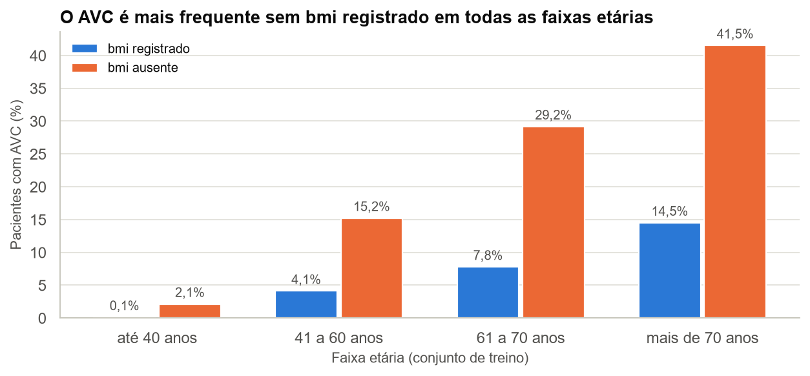
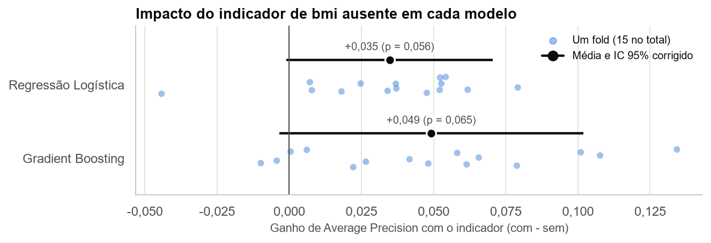
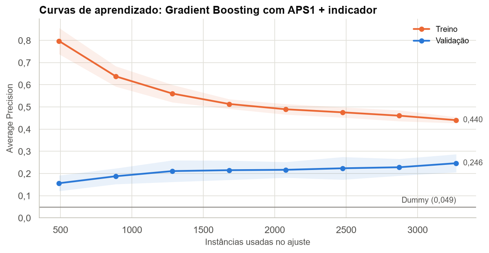

# Mudança no Pipeline e Curvas de Aprendizado

## 1.3 Mudança no pipeline: indicador de `bmi` ausente

**Correção da APS1.** A APS1 afirmou que não havia evidência de associação entre a ausência de `bmi` e o *target*. Verificando no treino, o dado mostra o contrário.



| Faixa etária (treino) | AVC com `bmi` registrado | AVC sem `bmi` registrado |
|---|---:|---:|
| até 40 anos | 2 de 1733 (0,1%) | 1 de 47 (2,1%) |
| 41 a 60 anos | 50 de 1218 (4,1%) | 7 de 46 (15,2%) |
| 61 a 70 anos | 35 de 450 (7,8%) | 7 de 24 (29,2%) |
| mais de 70 anos | 75 de 517 (14,5%) | 22 de 53 (41,5%) |

AVC ocorre em 21,8% dos pacientes sem `bmi` registrado e em 4,1% dos demais (razão de chances de 6,45; teste de Fisher, p ≈ 1,5 × 10⁻¹⁵). A diferença aparece em todas as faixas etárias e resiste ao ajuste pelas demais variáveis (razão de chances ajustada de 4,18). Ao imputar a mediana, o pipeline da APS1 trata esses pacientes como casos comuns e apaga essa informação.

**Mudança proposta:** acrescentar um indicador binário de `bmi` ausente como terceiro ramo do `ColumnTransformer`, passando de 23 para 24 colunas. O restante do pipeline não muda. O `RobustScaler`, citado na APS1 como alternativa, não foi escolhido porque árvores de decisão dependem apenas da ordem dos valores e seriam indiferentes a ele.

**Risco assumido:** o indicador pode ser vazamento de dados (*leakage*; Kapoor; Narayanan, 2023). Se o `bmi` deixou de ser registrado porque o paciente já chegou com AVC, a ausência é consequência do desfecho e não estaria disponível para prever um caso futuro. A documentação do dataset não permite confirmar nem descartar essa hipótese. Por isso, a Seção 2.6 mede quanto o resultado depende do indicador.

```python
def pipeline_com_indicador():
    return Pipeline(steps=[("preprocessor", ColumnTransformer(
        transformadores_aps1() + [("bmi_ausente", MissingIndicator(features="all"), ["bmi"])]
    ))])
```

| Modelo | Pipeline | AP média | Desvio-padrão |
|---|---|---:|---:|
| Regressão Logística | APS1 | 0,190 | 0,045 |
| Gradient Boosting | APS1 | 0,202 | 0,039 |
| Regressão Logística | APS1 + indicador | 0,225 | 0,033 |
| Gradient Boosting | APS1 + indicador | 0,252 | 0,042 |

| Modelo | Ganho de AP | IC 95% corrigido | p | Folds com ganho |
|---|---:|---:|---:|---:|
| Regressão Logística | +0,035 | -0,001 a +0,071 | 0,056 | 93% |
| Gradient Boosting | +0,049 | -0,003 a +0,102 | 0,065 | 87% |



A nova seleção de hiperparâmetros usou os mesmos espaços de busca, folds, métrica e semente. O enunciado pede a avaliação no melhor modelo (Gradient Boosting); repetimos na regressão logística para verificar se a ordem entre os modelos mudaria.

O indicador elevou a AP do Gradient Boosting de 0,202 para 0,252 (+0,049) e a da regressão logística de 0,190 para 0,225 (+0,035), com ganho em 87% e 93% dos folds. A direção é consistente, mas o ganho não atinge significância de 5% no teste corrigido (p = 0,065 e 0,056): os intervalos de confiança incluem valores ligeiramente negativos. Tratamos esse resultado como evidência sugestiva, e não conclusiva.

A regressão logística escolheu `C = 100`, no limite da grade, mas estender a grade não mudaria o resultado: a AP está estável de `C = 1` (0,2237) a `C = 100` (0,2248). Nessa região a penalidade quase não atua, e regularizar mais só piora este modelo.

| Modelo com indicador | Melhores hiperparâmetros |
|---|---|
| Regressão logística | `C` = 100, Elastic Net (`l1_ratio` = 0,5), `class_weight` = None |
| Gradient Boosting | `learning_rate` = 0,047, `n_estimators` = 148, `max_depth` = 3, `min_samples_leaf` = 25, `subsample` = 0,99, `max_features` = sqrt |

**Melhor modelo: Gradient Boosting com o indicador** (AP de 0,252). A regra, fixada antes de olhar o teste, é escolher a maior AP média. A vantagem sobre a regressão logística com indicador (+0,027; IC 95% de -0,011 a +0,065; p = 0,15) não é significativa, portanto não há evidência de diferença real entre os dois nesta amostra.

## 1.4 Curvas de aprendizado do melhor modelo



| Instâncias de treino | AP de treino | AP de validação | Desvio-padrão (validação) |
|---|---:|---:|---:|
| 490 | 0,797 | 0,156 | 0,035 |
| 887 | 0,638 | 0,188 | 0,036 |
| 1284 | 0,560 | 0,211 | 0,049 |
| 1681 | 0,513 | 0,215 | 0,044 |
| 2078 | 0,489 | 0,217 | 0,035 |
| 2475 | 0,476 | 0,223 | 0,051 |
| 2872 | 0,460 | 0,228 | 0,038 |
| 3270 | 0,440 | 0,246 | 0,041 |

A AP de treino cai de 0,797 para 0,440 conforme a amostra cresce, enquanto a de validação sobe de 0,156 para 0,246. A diferença de aproximadamente 0,19 entre as curvas de treino e validação sugere **sobreajuste**, indicando que o modelo ainda pode estar aprendendo particularidades dos dados de treinamento. A curva de validação continua subindo, sugerindo que mais dados, especialmente mais casos de AVC, podem melhorar a capacidade de generalização do modelo. O ganho dos últimos passos deve ser lido com cautela, pois o desvio-padrão entre folds é de cerca de 0,04.

O último ponto (0,246) difere da AP da busca (0,252) porque a curva embaralha as linhas e altera os sorteios internos do modelo. Essa diferença dá uma ideia do ruído de uma execução.
