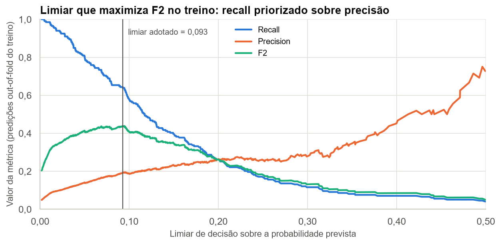
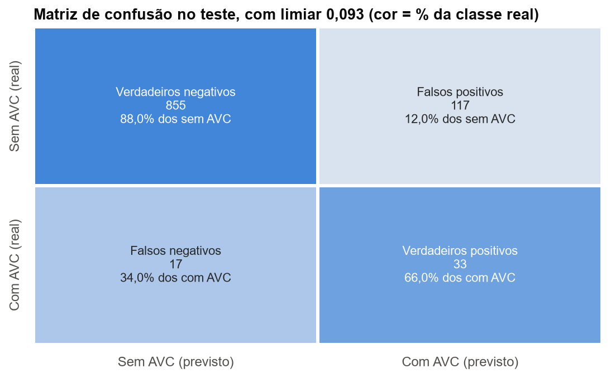
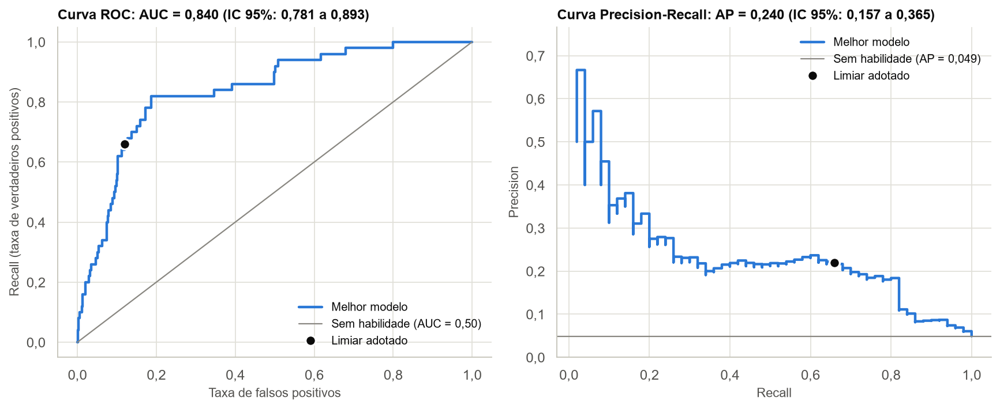

# Avaliação no Teste

## 2.1 Escolha do limiar de decisão

A AP não depende de limiar, mas Accuracy, Precision, Recall, F1 e a matriz de confusão dependem. O limiar padrão de 0,5 é inadequado para um evento raro. Escolhemos o limiar que **maximiza F2** nas predições *out-of-fold* do treino. O F2 pesa o recall mais do que a precisão, pois em uma triagem perder um AVC custa mais do que gerar um falso alarme.

```python
proba_oof = cross_val_predict(melhor_modelo, X_train, y_train, cv=cv_limiar,
                              method="predict_proba", n_jobs=-1)[:, 1]
precisao, revocacao, limiares = precision_recall_curve(y_train, proba_oof)
precisao, revocacao = precisao[:-1], revocacao[:-1]
f2 = 5 * precisao * revocacao / np.clip(4 * precisao + revocacao, 1e-12, None)
limiar = limiares[f2.argmax()]
```



O limiar adotado é 0,093: pacientes com risco previsto a partir de 9,3% são sinalizados. A curva de F2 é quase plana nessa região (fica a menos de 2% do máximo entre 0,065 e 0,096), portanto o limiar exato é pouco determinado. A Seção 2.5 mede o efeito disso.

## 2.2 Accuracy, Precision, Recall e F1

Avaliação única do modelo, do pipeline e do limiar já fixados. Os intervalos de confiança vêm de *bootstrap* com 2.000 reamostragens, pois o teste tem apenas 50 AVCs.

| Métrica | Melhor modelo | IC 95% | Dummy |
|---|---:|---:|---:|
| Average Precision | 0,240 | 0,157 a 0,365 | 0,049 |
| ROC-AUC | 0,840 | 0,781 a 0,893 | 0,500 |
| Recall | 0,660 | 0,528 a 0,791 | 0,000 |
| Precision | 0,220 | 0,156 a 0,288 | 0,000 |
| F1 | 0,330 | 0,246 a 0,413 | 0,000 |
| Accuracy | 0,869 | 0,847 a 0,888 | 0,951 |

- **Accuracy (0,869):** é menor que a do Dummy (0,951), que nunca prevê AVC e por isso não detecta nenhum caso. Com esta prevalência, a métrica não ajuda a comparar os modelos.
- **Recall (0,660) e Precision (0,220):** o modelo detecta cerca de 2 em cada 3 AVCs, e 22% dos pacientes sinalizados tiveram AVC, 4,5 vezes a prevalência.
- **AP (0,240):** ficou próxima da média obtida na validação cruzada (0,252), sugerindo consistência entre os resultados. Entretanto, o número reduzido de casos positivos no teste limita a precisão dessa avaliação.
- **Incerteza:** os intervalos são largos. O recall, por exemplo, vai de 0,528 a 0,791.

## 2.3 Matriz de confusão



| Critério do limiar | Limiar | Precision | Recall | VP | FP | FN |
|---|---:|---:|---:|---:|---:|---:|
| F2 máximo (adotado) | 0,093 | 0,220 | 0,660 | 33 | 117 | 17 |
| F1 máximo | 0,095 | 0,221 | 0,660 | 33 | 116 | 17 |
| Recall de ao menos 80% | 0,050 | 0,147 | 0,820 | 41 | 238 | 9 |
| 0,50 (padrão) | 0,500 | 0,500 | 0,020 | 1 | 1 | 49 |

- **Falsos negativos (17):** AVCs não detectados, o erro mais grave em uma triagem.
- **Falsos positivos (117):** pacientes sem AVC registrado que seriam encaminhados para avaliação.
- **Carga de trabalho:** o modelo sinaliza 150 dos 1.022 pacientes (14,7%), ou 4,5 alertas por AVC detectado.

A tabela de pontos de operação mostra a troca entre esses erros, sem alterar o limiar adotado. Exigir recall de ao menos 80% no treino detecta mais 8 AVCs no teste, ao custo de 121 falsos positivos adicionais. O limiar de 0,5 detecta apenas 1 AVC. Neste modelo, os limiares de F1 e F2 praticamente coincidem.

## 2.4 Curva ROC e ROC-AUC



A ROC-AUC de 0,840 (IC 95% de 0,781 a 0,893) indica boa capacidade de ordenar pacientes por risco. A curva Precision-Recall mostra o outro lado: a precisão fica perto de 0,2 em boa parte da faixa de recall. Uma taxa de falsos positivos de apenas 12% gera 117 falsos alarmes porque há muito mais pacientes sem AVC do que com AVC. Esse contraste justifica a escolha da AP como métrica principal.

## 2.5 Estabilidade do limiar

| Em 10 outras divisões do treino | Mínimo | Mediana | Máximo |
|---|---:|---:|---:|
| Limiar por F2 | 0,053 | 0,070 | 0,088 |
| Recall no teste | 0,68 | 0,78 | 0,82 |
| Precision no teste | 0,15 | 0,18 | 0,21 |

Repetimos a escolha do limiar em 10 outras divisões do treino. O limiar variou de 0,053 a 0,088, e o recall no teste, de 0,68 a 0,82 (mediana de 0,78), com precisão de 0,15 a 0,21. O limiar adotado (0,093) ficou acima de todos eles, então o recall de 0,66 está na ponta conservadora do que o procedimento poderia produzir.

Mantivemos o limiar definido antes do teste, pois trocá-lo agora seria ajustá-lo ao teste. A conclusão prática é que o F2 não define um único ponto de operação com precisão. Em uso real, o limiar deveria considerar também a capacidade de atendimento.

## 2.6 Análise de sensibilidade: com e sem o indicador

| Modelo e pacientes | AP | ROC-AUC | Precision | Recall | F1 | Limiar |
|---|---:|---:|---:|---:|---:|---:|
| Com indicador (todos) | 0,240 | 0,840 | 0,220 | 0,660 | 0,330 | 0,093 |
| Sem indicador (todos) | 0,251 | 0,833 | 0,159 | 0,740 | 0,262 | 0,066 |
| Com indicador (com `bmi`) | 0,244 | 0,842 | 0,225 | 0,660 | 0,335 | 0,093 |
| Sem indicador (com `bmi`) | 0,231 | 0,838 | 0,161 | 0,745 | 0,264 | 0,066 |

**O ganho da validação cruzada não se repetiu no teste.** A AP foi de 0,240 com o indicador e 0,251 sem ele (diferença de -0,011; IC 95% de -0,061 a +0,054), e a ROC-AUC, de 0,840 e 0,833. O intervalo inclui tanto ganho quanto perda, portanto o teste não confirma nem descarta o efeito.

A amostra explica parte disso: o teste tem apenas 31 pacientes sem `bmi`, dos quais 3 com AVC. A taxa nesse grupo (9,7%, contra 4,7% dos demais) é bem menor que a do treino (21,8%).

Cada versão usa o próprio limiar de F2, então os pontos de operação diferem: com o indicador, Precision de 0,22 e Recall de 0,66; sem ele, 0,16 e 0,74.

Mantivemos o modelo escolhido pela regra definida antes do teste, pois trocá-lo agora seria usar o teste para selecionar. Para uso real, **a versão sem indicador é a alternativa mais segura** até que se esclareça por que o `bmi` está ausente.
